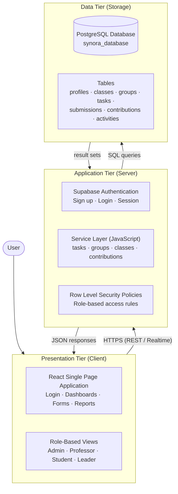

# Software Architecture
## Group Contribution Monitoring System (Synora)

---

## Architecture Type: **Three-Tier Architecture**

---

## Overview

The Group Contribution Monitoring System (Synora) adapts the **Three-Tier Architecture**, a widely used software architecture pattern that separates an application into three distinct logical and physical layers: the **Presentation Tier**, the **Application Tier**, and the **Data Tier**. Each tier has a well-defined responsibility and communicates only with its adjacent tier, which promotes separation of concerns, maintainability, and scalability of the system.

---

## Architecture Diagram

---

## The Three Tiers

### Tier 1 — Presentation Tier (Client Side)

The Presentation Tier is the user interface layer of the system, implemented as a **React single-page application (SPA)** running in the web browser. It is responsible for displaying data to the user and capturing user inputs such as login credentials, class details, task submissions, and evaluation ratings.

This tier contains the pages and components for all four user roles — the administrator's user management screens, the professor's class and group monitoring pages, the student's task and activity pages, and the group leader's task assignment and submission review pages. The tier also enforces **role-based navigation**, redirecting each user to the appropriate dashboard according to their role.

The Presentation Tier does not interact with the database directly. Instead, it communicates with the Application Tier through secure HTTPS requests and displays only the data that the Application Tier permits for the current user.

---

### Tier 2 — Application Tier (Business Logic)

The Application Tier is the middle layer that contains the **business logic and processing rules** of the system. It receives requests from the Presentation Tier, validates and processes them, and communicates with the Data Tier to store or retrieve information. In Synora, this tier is composed of three components:

1. **Supabase Authentication** — handles account registration, login, password validation, and session management for all users.
2. **JavaScript Service Layer** — a collection of service modules (authentication, classes, groups, tasks, submissions, contributions, and activities) that execute the system's operations, such as computing contribution percentages, assigning tasks, and recording activity history.
3. **Row Level Security (RLS) Policies** — database-enforced rules that restrict what each authenticated user is allowed to read or modify, ensuring that students can only access their own classes and groups, leaders can only manage their own group, and professors can only manage their own classes.

This tier acts as the gatekeeper between the user and the data. No request from the Presentation Tier reaches the database unless it passes the authentication, validation, and security rules defined at this layer.

---

### Tier 3 — Data Tier (Database Storage)

The Data Tier is responsible for the **permanent storage and retrieval of all system data**. It is implemented using a **PostgreSQL database** hosted on Supabase, locally named **synora_database**.

The database stores all entities described in the Entity Relationship Diagram — profiles, classes, projects, groups, tasks, submissions, contributions, class_students, group_members, and activities. The Data Tier receives structured queries from the Application Tier and returns result sets, such as the list of a student's assigned tasks or the contribution percentages of a group.

By isolating data in its own tier, the system ensures data integrity, consistency, and security. All access is controlled by the Application Tier, and the data structure remains independent of the user interface, allowing the system to evolve without altering the stored information.

---

## How the Tiers Work Together (Sample Flow)

A simple example — a student submitting a task:

| Step | Tier | Action |
|------|------|--------|
| 1 | Presentation | Student uploads files and clicks **Submit Task** |
| 2 | Presentation → Application | The request is sent over HTTPS to the service layer |
| 3 | Application | Authentication verifies the user; RLS confirms the student owns the task |
| 4 | Application → Data | The submission and new task status are written to the database |
| 5 | Data → Application | The database confirms the record was saved |
| 6 | Application → Presentation | A success response is returned and the UI updates |

---

## Why Three-Tier Architecture?

- **Separation of Concerns** — each tier has a single responsibility, making the system easier to understand and maintain.
- **Security** — the database is never exposed directly to the client; all access passes through authentication and RLS policies in the Application Tier.
- **Scalability** — each tier can be scaled independently; the interface, logic, and database can be upgraded without affecting the others.
- **Reusability** — the Application Tier's service layer can be reused by any client, such as a future mobile application.
- **Maintainability** — changes confined to one tier do not require modifications to the other tiers.

---

## Tier Summary

| Tier | Technology | Responsibility |
|------|-----------|----------------|
| Presentation | React (Vite), CSS | User interface and role-based views |
| Application | Supabase Auth, JavaScript services, RLS | Business logic, validation, security |
| Data | PostgreSQL (Supabase) | Permanent data storage |

---

*Document Version: 1.0*
*Last Updated: September 26, 2026*
