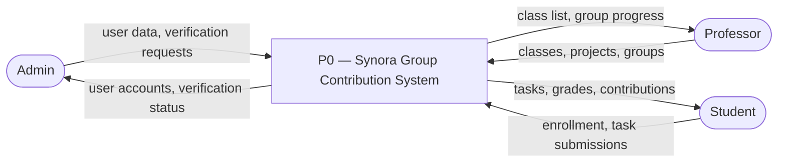
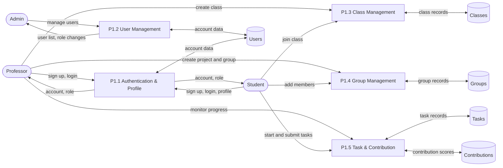
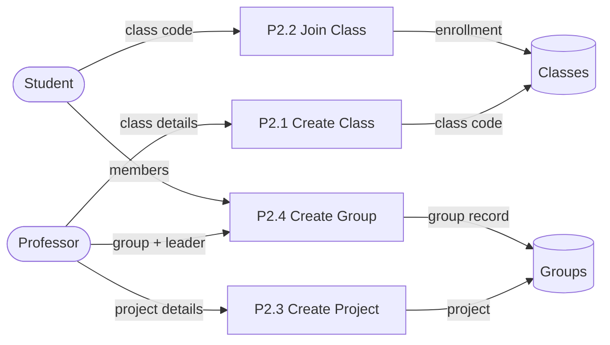
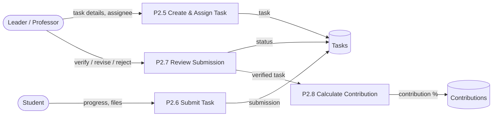
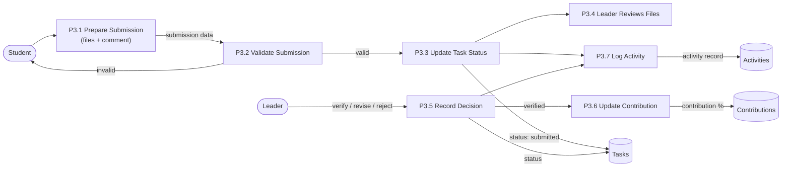

# Synora — Data Flow Diagram (DFD Level 0–3)

---

## Level 0 — Context Diagram

The whole system shown as a single process. The three external entities interact with the system. (Leader is a student with extra privileges, so it is not a separate entity.)

**Key Points:**
- Admin manages users and verifies professor accounts
- Professor creates classes, projects, and groups
- Student joins classes, does tasks, and submits work
- Data stores are not shown at this level — they appear starting at Level 1

**Explanation:**

Level 0, also known as the **context diagram**, is the highest and most simplified view of the Data Flow Diagram. It represents the entire Group Contribution Monitoring System as a single process labeled **P0**, without exposing the internal operations of the system. Surrounding the process are the three (3) external entities — the Administrator, the Professor, and the Student — which represent the user roles that exchange data with the system. The arrows, or **data flows**, show what information moves between each entity and the process: the Administrator submits user data and verification requests while receiving user accounts and verification status; the Professor provides classes, projects, and groups while receiving class lists and group progress; and the Student submits enrollment and task submissions while receiving tasks, grades, and contributions. At this level, no data stores are shown because the purpose of the context diagram is simply to define the boundaries of the system and identify who interacts with it and what data is exchanged.

---

## Level 1 — Main Processes

The system is split into five main processes.

**Key Points:**
- P1.1 handles sign up, login, and profile completion
- P1.2 handles admin user management
- P1.3 handles classes (professor creates, student joins)
- P1.4 handles projects and groups
- P1.5 handles tasks, submissions, and contribution scores

**Explanation:**

Level 1 is the first decomposition of the context diagram, where the single process **P0** is broken down into **five (5) main processes** that represent the major functional areas of the system. **P1.1 Authentication & Profile** processes the sign up, login, and profile completion of all users and stores account data in the Users data store. **P1.2 User Management** handles the administrator's operations for managing accounts and role changes. **P1.3 Class Management** processes the creation of classes by professors and the enrollment of students using the class code, storing class records in the Classes data store. **P1.4 Group Management** handles the creation of projects and groups as well as the addition of members, with records kept in the Groups data store. Finally, **P1.5 Task & Contribution** processes the assignment and submission of tasks and the computation of contribution percentages, updating both the Tasks and Contributions data stores. At this level, the five data stores are introduced to show where information is persisted, and each external entity is connected only to the processes it directly interacts with.

---

## Level 2 — Breakdown of Main Processes

Level 2 further decomposes the main processes of Level 1 into more specific sub-processes. Two diagrams are provided: one for Class and Group Management (P1.3 and P1.4) and one for Task and Contribution Management (P1.5).

**Explanation:**

Level 2 presents a more detailed view by breaking the Level 1 processes into their individual steps. Because the processes are independent of one another, they are separated into two diagrams instead of one — a common and accepted practice in DFD modeling. The first diagram decomposes **P1.3 Class Management** and **P1.4 Group Management** into four sub-processes. **P2.1 Create Class** receives the class details from the professor, generates a class code, and stores the class record in the Classes data store, while **P2.2 Join Class** receives the class code from the student and writes the enrollment record to the same data store. **P2.3 Create Project** receives the project details from the professor and stores the project, and **P2.4 Create Group** receives the group, leader, and member information and saves the resulting group record in the Groups data store. The second diagram decomposes **P1.5 Task & Contribution** into another four sub-processes that describe the complete task lifecycle. **P2.5 Create & Assign Task** receives the task details and assignee from the leader or professor and stores the task record, while **P2.6 Submit Task** receives the progress and files from the student and writes the submission to the Tasks data store. **P2.7 Review Submission** receives the decision of the leader — whether to verify, request revision, or reject — and updates the task status accordingly, and once a submission is verified, **P2.8 Calculate Contribution** computes the contribution percentage of the student and stores it in the Contributions data store. Together, these eight sub-processes fully describe how classes and groups are organized and how a single task flows from creation to the final measurement of a student's contribution.

### P1.3 & P1.4 — Class and Group Management

**Key Points:**
- Professor creates a class and gets a class code
- Student joins using the code
- Professor creates a project, then picks a leader for the group
- Leader adds members after the group is created

### P1.5 — Task & Contribution Management

**Key Points:**
- Leader creates and assigns a task to a member
- Student starts and submits the task
- Leader reviews and verifies the submission
- The system calculates the contribution percentage

---

## Level 3 — Breakdown of Task Submission (P2.6 + P2.7)

The deepest level: how one task goes from submission to a contribution score.

**Key Points:**
- Student attaches files and a comment, then submits
- The system validates the submission and updates the task status
- Leader checks the files and chooses verify, revise, or reject
- Every action is recorded in the activity log
- Verified tasks update the contribution score

**Explanation:**

Level 3 is the lowest and most detailed level of the Data Flow Diagram, decomposing the submission and review sub-processes of Level 2 into **seven (7) atomic operations**. The flow begins when the student performs **P3.1 Prepare Submission** by attaching files and a comment. The data then passes through **P3.2 Validate Submission**, which checks whether the submission is complete — if the data is invalid, it is sent back to the student for correction; if valid, it proceeds to **P3.3 Update Task Status**, which sets the task status to *submitted* in the Tasks data store and forwards the record to **P3.4 Leader Reviews Files**. The leader then makes a decision through **P3.5 Record Decision**, which updates the task status and, when verified, triggers **P3.6 Update Contribution** to compute and store the new contribution percentage. Both the submission and the review decision are recorded by **P3.7 Log Activity**, which writes an entry to the Activities data store for the student's activity timeline. Level 3 therefore shows the complete and precise journey of one data item — a task submission — from input, through validation and evaluation, to its final effect on the student's contribution score.

---

## Summary

| Level | What it shows |
|-------|---------------|
| Level 0 | Whole system as one process with Admin, Professor, Student |
| Level 1 | Five main processes (Auth, Users, Classes, Groups, Tasks) |
| Level 2 | Class/Group creation and the Task lifecycle split into steps |
| Level 3 | One submission going through validation, review, scoring, and logging |
