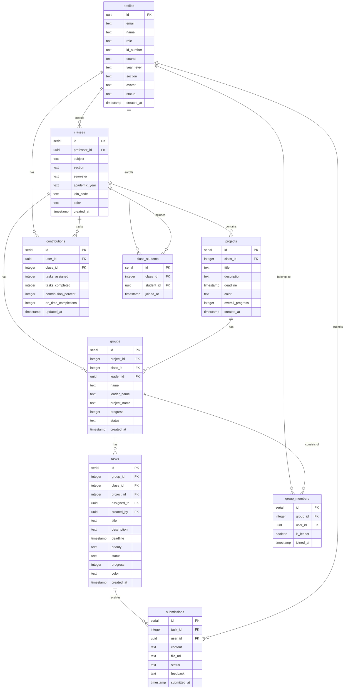

# Entity Relationship Diagram (ERD)
## Group Contribution Monitoring System (Synora)

---

## Database: **synora_database**

---

## Overall ERD Explanation

The Entity Relationship Diagram (ERD) of the Group Contribution Monitoring System, locally known as Synora, presents the logical structure of the **synora_database** which serves as the central repository of the entire system. The database is composed of ten (10) entities that are strategically organized to support the four main user roles — administrator, professor, student, and group leader — and to sustain the core business process of monitoring individual contributions within a group.

At the center of the diagram is the **profiles** entity, which stores the account information of every registered user in the system. It serves as the primary reference table for all other entities, since every action performed in the system — creating classes, joining groups, submitting tasks, and recording contributions — is always linked to a specific user. Each profile is identified by a unique UUID and is classified through the *role* attribute as either an administrator, professor, or student.

The academic hierarchy of the system is represented by four interconnected entities: **classes, projects, groups, and tasks**. A professor creates classes, and each class may contain multiple projects. Within a class, the professor organizes students into groups where each group is assigned to a specific project and is headed by an elected leader. Tasks are then created under each group and are assigned to individual members. This chain of relationships follows a one-to-many cardinality, meaning one class can hold many projects, one project can accommodate many groups, and one group can contain many tasks.

The participation of students in classes and groups is handled by two junction tables: **class_students** and **group_members**. These tables resolve the many-to-many relationships between profiles and classes, and between profiles and groups, respectively. Through these entities, a student may enroll in multiple classes and may belong to a group, while a class or group may contain multiple students. The *is_leader* attribute in the group_members table further designates which member serves as the group leader, which the system uses to determine the additional leadership privileges of a student account.

The evaluation process of the system is supported by the **submissions** and **contributions** entities. Every task may receive one or more submissions from the assigned student, which are then reviewed and verified by the group leader. Once a submission is verified, the system updates the contribution record of the student, which stores the number of tasks assigned, the number of tasks completed, and the overall contribution percentage of the student per class. It is through this mechanism that the system is able to measure and monitor the individual participation of each member within the group.

Overall, the ERD follows the basic principles of relational database design. Each table is identified by a primary key, all foreign keys properly reference their parent entities, and redundant data is minimized through normalization. The structure ensures data integrity and consistency while providing a reliable foundation for the reporting, monitoring, and evaluation functions of the Group Contribution Monitoring System.

---

## Entity Relationship Diagram (Mermaid)



---

## Major Entities

### Entity 1: profiles
Stores user account information for all system users (admin, professor, student).

| Column | Type | Description |
|--------|------|-------------|
| id | UUID (PK) | Unique user identifier |
| email | TEXT | User email address |
| name | TEXT | User full name |
| role | TEXT | User role (admin, professor, student) |
| id_number | TEXT | Student/Professor ID number |
| course | TEXT | Student's course |
| year_level | TEXT | Student's year level |
| section | TEXT | Student's section |
| avatar | TEXT | User avatar initials |
| status | TEXT | Account status (active, pending) |
| created_at | TIMESTAMP | Account creation date |

---

### Entity 2: classes
Stores class/course information created by professors.

| Column | Type | Description |
|--------|------|-------------|
| id | SERIAL (PK) | Unique class identifier |
| professor_id | UUID (FK) | Reference to profiles |
| subject | TEXT | Class subject name |
| section | TEXT | Class section |
| semester | TEXT | Semester |
| academic_year | TEXT | Academic year |
| join_code | TEXT | Unique code for students to join |
| color | TEXT | Class color theme |
| created_at | TIMESTAMP | Class creation date |

---

### Entity 3: groups
Stores group information created by professors for projects.

| Column | Type | Description |
|--------|------|-------------|
| id | SERIAL (PK) | Unique group identifier |
| project_id | INTEGER (FK) | Reference to projects |
| class_id | INTEGER (FK) | Reference to classes |
| leader_id | UUID (FK) | Reference to profiles (leader) |
| name | TEXT | Group name |
| leader_name | TEXT | Leader's name |
| progress | INTEGER | Group progress percentage |
| status | TEXT | Group status (active) |
| created_at | TIMESTAMP | Group creation date |

---

### Entity 4: tasks
Stores tasks assigned to groups/members.

| Column | Type | Description |
|--------|------|-------------|
| id | SERIAL (PK) | Unique task identifier |
| group_id | INTEGER (FK) | Reference to groups |
| class_id | INTEGER (FK) | Reference to classes |
| project_id | INTEGER (FK) | Reference to projects |
| title | TEXT | Task title |
| description | TEXT | Task description |
| assigned_to | UUID (FK) | Reference to profiles (assignee) |
| created_by | UUID (FK) | Reference to profiles (creator) |
| deadline | TIMESTAMP | Task deadline |
| priority | TEXT | Task priority (low, medium, high) |
| status | TEXT | Task status |
| progress | INTEGER | Task progress percentage |
| created_at | TIMESTAMP | Task creation date |

---

## Supporting Entities

| Entity | Purpose |
|--------|---------|
| **projects** | Stores project details linked to classes |
| **class_students** | Links students to classes (enrollment) |
| **group_members** | Links students to groups (membership) |
| **submissions** | Stores task submissions from students |
| **contributions** | Stores student contribution records |
| **activities** | Stores user activity history |

---

## Entity Relationships

```
profiles ──────┐
               │
               ├──1:M──► classes ──────┐
               │                       │
               │                       ├──1:M──► projects ──────┐
               │                       │                         │
               │                       ├──1:M──► groups ─────┐  │
               │                       │                     │  │
               │                       │                     ├──1:M──► tasks
               │                       │                     │
               │                       │                     ├──M:M──► group_members ──── profiles
               │                       │                     │
               │                       │                     └──1:M──► submissions
               │                       │
               │                       └──M:M──► class_students ──── profiles
               │
               └──1:M──► contributions
```

---

## Relationship Explanations

### 1. profiles → classes (One-to-Many)
- **One** professor can create **many** classes
- A class belongs to **one** professor
- Relationship: `classes.professor_id → profiles.id`

### 2. classes → projects (One-to-Many)
- **One** class can have **many** projects
- A project belongs to **one** class
- Relationship: `projects.class_id → classes.id`

### 3. classes → groups (One-to-Many)
- **One** class can have **many** groups
- A group belongs to **one** class
- Relationship: `groups.class_id → classes.id`

### 4. projects → groups (One-to-Many)
- **One** project can have **many** groups
- A group belongs to **one** project
- Relationship: `groups.project_id → projects.id`

### 5. groups → tasks (One-to-Many)
- **One** group can have **many** tasks
- A task belongs to **one** group
- Relationship: `tasks.group_id → groups.id`

### 6. profiles → group_members ← groups (Many-to-Many)
- **One** student can be in **many** groups
- **One** group can have **many** members
- Resolved through `group_members` junction table

### 7. profiles → class_students ← classes (Many-to-Many)
- **One** student can enroll in **many** classes
- **One** class can have **many** students
- Resolved through `class_students` junction table

### 8. tasks → submissions (One-to-Many)
- **One** task can have **many** submissions
- A submission belongs to **one** task
- Relationship: `submissions.task_id → tasks.id`

### 9. profiles → contributions (One-to-Many)
- **One** student can have **many** contribution records
- A contribution belongs to **one** student
- Relationship: `contributions.user_id → profiles.id`

---

## Summary

| Relationship | Type | Description |
|--------------|------|-------------|
| Professor → Classes | 1:M | Professor creates many classes |
| Class → Projects | 1:M | Class contains many projects |
| Class → Groups | 1:M | Class has many groups |
| Project → Groups | 1:M | Project has many groups |
| Group → Tasks | 1:M | Group has many tasks |
| Student ↔ Groups | M:M | Students join multiple groups |
| Student ↔ Classes | M:M | Students enroll in multiple classes |
| Task → Submissions | 1:M | Task has many submissions |
| Student → Contributions | 1:M | Student has many contribution records |

---

*Document Version: 1.0*
*Last Updated: September 23, 2026*
