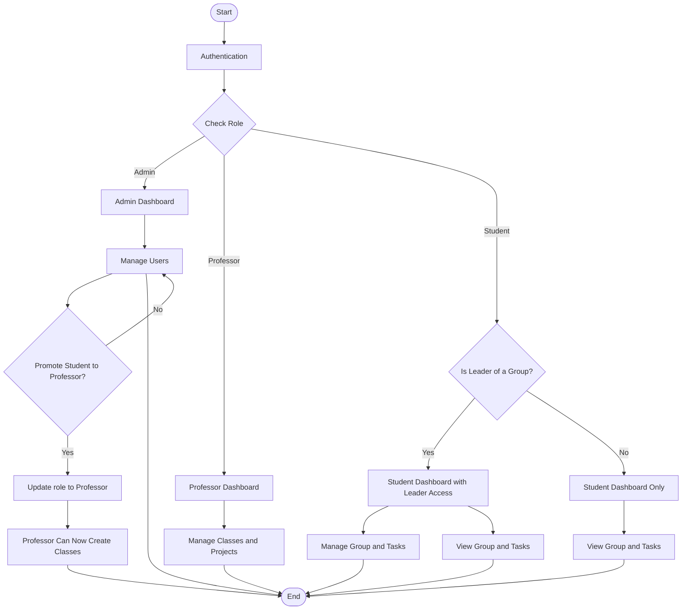
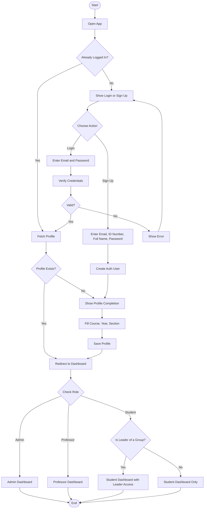
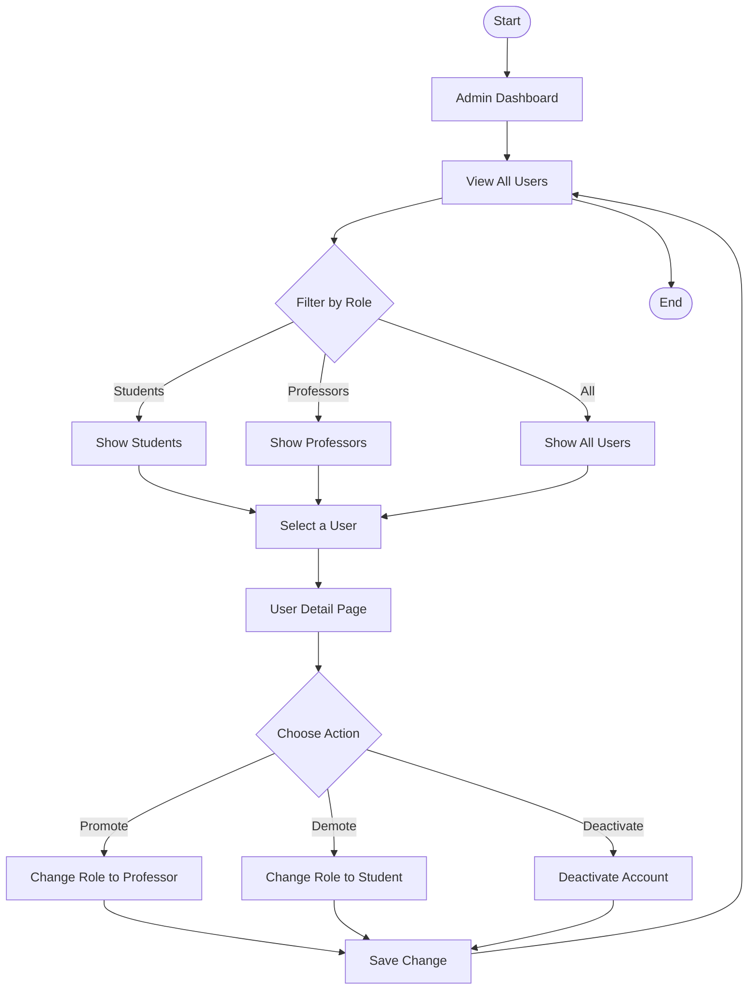
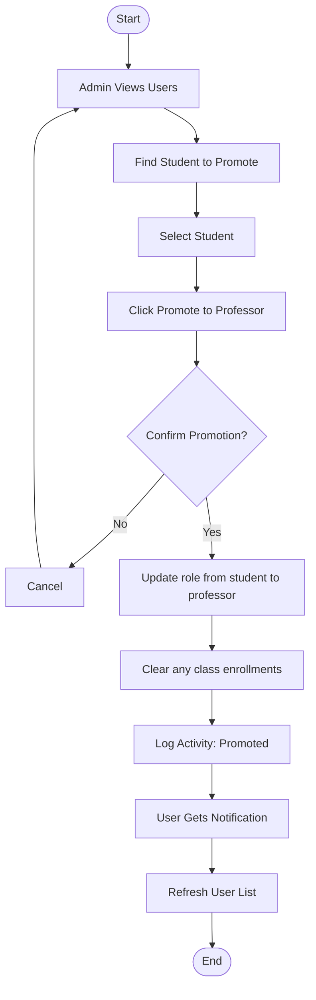
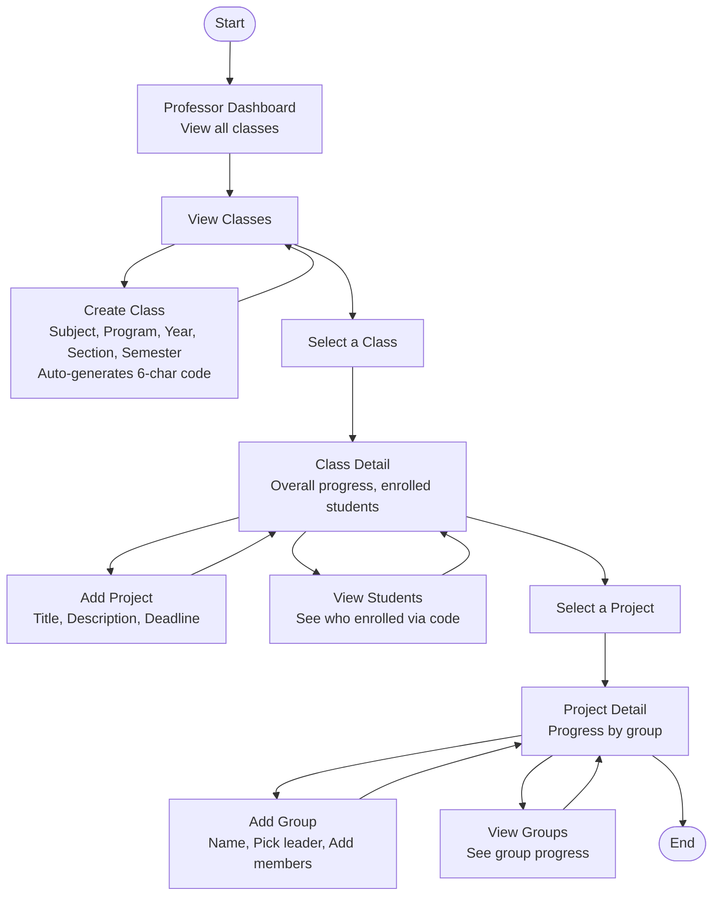
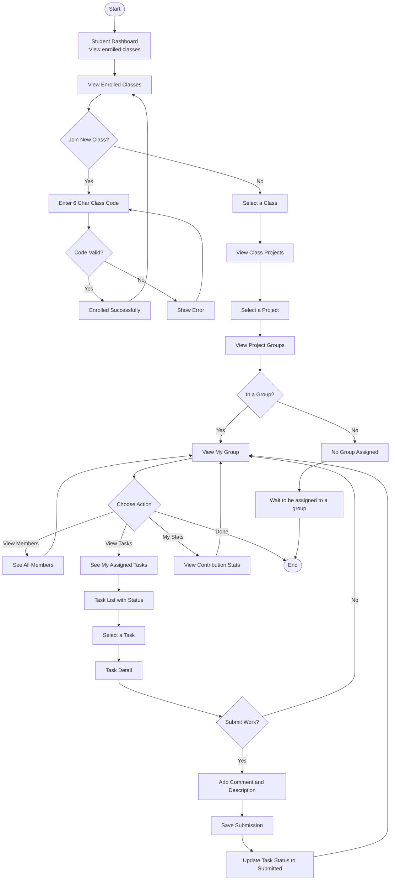
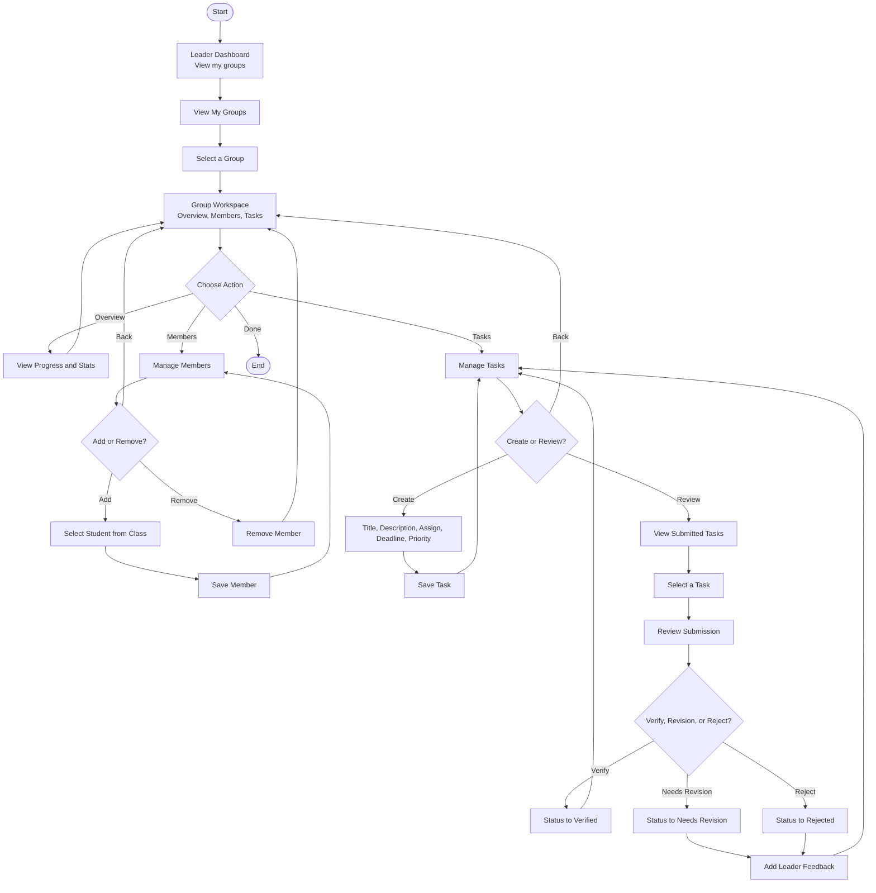
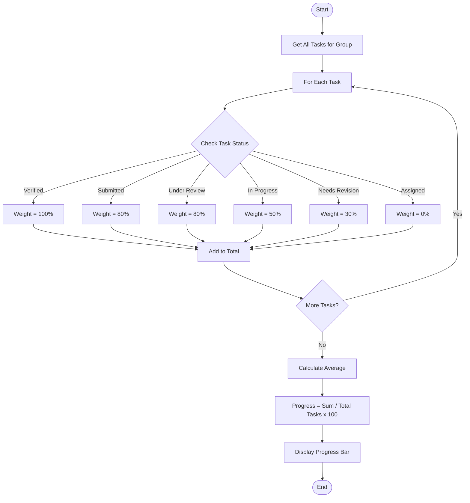
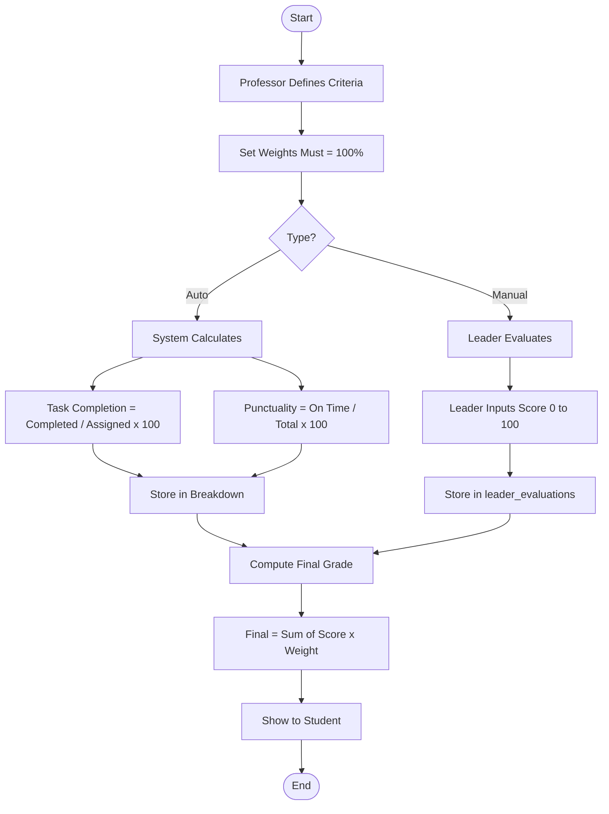

# Synora — System Flowchart

---

## System Overview

This is the high-level view of the entire Synora system. It shows how the four user roles (Admin, Professor, Student, Leader) interact with the system after logging in.

**Key Points:**
- The system checks the user's role after authentication
- Admins manage users and can promote students to professors
- Professors manage classes, projects, and groups
- Students who are group leaders get additional access to manage their group
- Regular students can only view their group and tasks



---

## Authentication Flow

This flow handles user login, sign up, and profile setup. It's the entry point for all users.

**Key Points:**
- New users must sign up with email, ID number, full name, and password
- After sign up, students must complete their profile (course, year, section)
- Returning users are logged in and redirected to their dashboard
- The system checks if the user is a leader to determine dashboard access
- Invalid credentials show an error and allow retry



---

## Admin Flow — User Management

This flow shows how the admin manages users in the system. The admin can view, filter, promote, demote, or deactivate users.

**Key Points:**
- Admin can filter users by role (Students, Professors, or All)
- Selecting a user shows their detail page
- Three actions available: Promote, Demote, or Deactivate
- Promote changes a student's role to professor
- Demote changes a professor's role back to student
- Deactivate disables the user's account
- All changes are saved and the user list refreshes



---

## Promotion Flow — Student to Professor

This flow shows the detailed steps when an admin promotes a student to professor. It includes confirmation, data cleanup, and notification.

**Key Points:**
- Admin selects a student and clicks "Promote to Professor"
- A confirmation dialog appears to prevent accidental promotions
- If confirmed, the system updates the user's role from student to professor
- Any existing class enrollments are cleared (professors don't enroll in classes)
- The action is logged in the activity table
- The promoted user receives a notification
- The user list refreshes to show the updated role



---

## Professor Flow

This flow shows how a professor manages their classes, projects, and groups. It's the main workflow for professors.

**Key Points:**
- Professor starts at the dashboard and views all their classes
- Can create a new class (auto-generates a 6-character code for students)
- Can select an existing class to view details
- From class detail, can add projects, view enrolled students, or select a project
- From project detail, can add groups (with leader and members) or view group progress
- The flow loops back after each action, allowing multiple operations



---

## Student Flow

This flow shows how a student interacts with the system — joining classes, viewing projects, and submitting tasks.

**Key Points:**
- Student starts at the dashboard and views enrolled classes
- Can join a new class by entering a 6-character code from the professor
- If the code is valid, enrollment succeeds; if not, an error is shown
- Can select a class to view its projects
- Can select a project to view its groups
- If assigned to a group, can view members, tasks, and contribution stats
- Can select a task and submit work with a comment/description
- If not assigned to a group, waits to be assigned by the leader
- "Done" option exits the flow



---

## Leader Flow

This flow shows how a group leader manages their group — adding/removing members, creating tasks, and reviewing submissions.

**Key Points:**
- Leader starts at the dashboard and views their groups
- Can select a group to open the Group Workspace
- From the workspace, can access Overview, Members, or Tasks
- **Members tab:** Add students from the class or remove members
- **Tasks tab:** Create new tasks (with title, description, assignee, deadline, priority) or review submitted tasks
- **Review decisions:** Verify (approve), Needs Revision (send back), or Reject
- If revision or rejection, leader adds feedback for the student
- "Done" option exits the flow



---

## Data Flow

This flow shows how data moves between users and the database. It visualizes the relationships between actions and database tables.

**Key Points:**
- **Professor** creates classes, projects, and groups → saved to respective tables
- **Student** joins classes using a code → saved to class_enrollments
- **Student** submits tasks → saved to submissions table
- **Leader** creates and assigns tasks → saved to tasks table
- **Leader** reviews submissions → updates tasks and submissions
- Task progress automatically updates contributions
- All actions are logged in the activities table

```mermaid
flowchart LR
    subgraph PROF[Professor]
        P1[Creates Class]
        P2[Creates Project]
        P3[Creates Group]
    end

    subgraph STUD[Student]
        S1[Joins Class]
        S2[Views Project]
        S3[Submits Task]
    end

    subgraph LEAD[Leader]
        L1[Creates Task]
        L2[Assigns Task]
        L3[Reviews Submission]
    end

    subgraph DB[(Supabase DB)]
        DB1[profiles]
        DB2[classes]
        DB3[projects]
        DB4[groups]
        DB5[group_members]
        DB6[tasks]
        DB7[submissions]
        DB8[contributions]
        DB9[activities]
    end

    P1 --> DB2
    P2 --> DB3
    P3 --> DB4
    S1 -->|class_code| DB2
    S3 --> DB7
    L1 --> DB6
    L2 --> DB6
    L3 --> DB6
    L3 --> DB7

    DB6 -->|progress| DB8
    DB7 -->|status| DB6
    DB9 -->|track| DB1
```

---

## Progress Calculation (Set Aside)

This flow shows how group progress is calculated using weighted task statuses. This feature is set aside for future implementation.

**Key Points:**
- The system gets all tasks for a group
- Each task's status is checked and assigned a weight:
  - Verified = 100%
  - Submitted = 80%
  - Under Review = 80%
  - In Progress = 50%
  - Needs Revision = 30%
  - Assigned = 0%
- Weights are summed and divided by total tasks
- Result is displayed as a progress percentage
- This formula is more accurate than just counting verified tasks



---

## Grading Flow (Set Aside)

This flow shows how individual student grades are calculated using a hybrid system of auto-calculated and manually-evaluated criteria. This feature is set aside for future implementation.

**Key Points:**
- Professor defines grading criteria with weights (must total 100%)
- Criteria can be Auto (system calculates) or Manual (leader evaluates)
- **Auto criteria:**
  - Task Completion = (completed tasks / assigned tasks) × 100
  - Punctuality = (on-time submissions / total submissions) × 100
- **Manual criteria:**
  - Leader inputs a score (0-100) for each member
- System computes the final grade using weighted average
- Student can view their grade breakdown



---

## Block Types Reference

| Shape | Mermaid Syntax | Use For |
|-------|---------------|---------|
| Oval | `([Text])` | Start / End |
| Rectangle | `[Text]` | Process / Action |
| Diamond | `{Text}` | Decision (Yes/No) |
| Parallelogram | `[/Text/]` | Input / Output |
| Subgraph | `subgraph Name ... end` | Grouping |
| Arrow | `-->` | Flow direction |

---

## How to Render

1. **GitHub** — Automatically renders Mermaid in `.md` files
2. **VS Code** — Install "Mermaid Preview" extension
3. **Online** — Paste into [mermaid.live](https://mermaid.live)
4. **Export** — Use mermaid.live to export as PNG/SVG

---

*Last updated: September 21, 2026*
